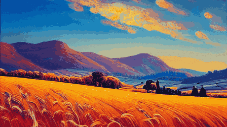

# Golden Field, a T3 Code theme

A dusk-tinted theme for [T3 Code](https://github.com/pingdotgg/t3code). It has a pixel-art wheat-field background with a halftone dot screen, frosted indigo panels, and amber and gold accents taken from the painting.



## Install

1. Download [`golden-field.json`](golden-field.json).
2. Put it in your T3 Code themes folder:
   ```sh
   mkdir -p ~/.t3/userdata/themes
   cp golden-field.json ~/.t3/userdata/themes/
   ```
3. Switch to it. Ask the T3 Code agent to "switch to the golden-field theme", or pick **Golden Field** in settings if your version lists saved themes.

## Notes

- The background image is built into the JSON file, so you don't need any other files.
- It's dark mode only, and it works on desktop and web. T3 Code themes don't apply on mobile.
- To go back, switch to a built-in theme: `t3-chat`, `grove`, `ocean`, `ember` or `iris`.
